# Bedrock Proxy

<p align="center">
  <strong>OpenAI & Anthropic compatible proxy for AWS Bedrock Mantle.</strong>
</p>

<p align="center">
  Run existing AI applications on AWS Bedrock without changing your code.
</p>

<p align="center">
  
</p>

---

## Overview

Bedrock Proxy is a lightweight compatibility layer that translates OpenAI and Anthropic API requests into AWS Bedrock Mantle requests.

Instead of modifying your applications, simply point your existing SDKs to this proxy.

It also provides optional integrations for persistent memory, execution tracing, caching, monitoring, and observability.

---

## Features

| Feature | Description |
|---------|-------------|
| OpenAI Compatible | Supports `/v1/chat/completions` |
| Anthropic Compatible | Supports `/v1/messages` |
| AWS Bedrock Mantle | Enterprise model hosting |
| Streaming | Real-time response streaming |
| Graphiti Memory | Long-term AI memory (optional) |
| PostgreSQL | Execution history (optional) |
| Redis | Response caching (optional) |
| Telegram | Monitoring & notifications (optional) |
| Health Checks | `/health`, `/ready`, `/alive` endpoints |
| TypeScript | Fully typed codebase |

---

## Architecture

```text
                         AI Applications
                     (OpenAI SDK / Claude SDK)

                              │
                              │
                              ▼

                    ┌─────────────────────┐
                    │    Bedrock Proxy    │
                    ├─────────────────────┤
                    │ Request Validation  │
                    │ Authentication      │
                    │ Model Translation   │
                    │ Streaming           │
                    │ Memory Integration  │
                    │ Logging             │
                    └──────────┬──────────┘
                               │
                               ▼

                      AWS Bedrock Mantle
                               │
                               ▼

                          Foundation Models
                            (GLM, Claude)
```

---

## Why Use This?

Most AI tooling today assumes OpenAI or Anthropic APIs.

AWS Bedrock provides enterprise-grade model hosting, but many applications don't support it natively.

Bedrock Proxy bridges that gap.

Your applications continue using familiar APIs while every request is transparently routed through AWS Bedrock.

---

## Supported APIs

### OpenAI

```
POST /v1/chat/completions
```

Compatible with:

- OpenAI SDK
- LangChain
- OpenHands
- Continue.dev
- RooCode
- Cursor
- Cline
- Any OpenAI-compatible client

### Anthropic

```
POST /v1/messages
```

Compatible with Claude SDK clients.

---

## Quick Start

### Clone

```bash
git clone https://github.com/<username>/bedrock-proxy.git
cd bedrock-proxy
```

### Install

```bash
npm install
```

### Configure

```bash
cp .env.example .env
```

Example `.env`:

```env
BEDROCK_MANTLE_API_KEY=xxxxxxxx
AWS_REGION=us-east-1
PORT=3000
```

### Start

Development:

```bash
npm run dev
```

Production:

```bash
npm run build
npm start
```

---

## Health Check

```bash
curl http://localhost:3000/health
```

Response:

```json
{
  "status": "healthy"
}
```

---

## Example Usage

### OpenAI SDK

```typescript
import OpenAI from "openai";

const client = new OpenAI({
    apiKey: "dummy",
    baseURL: "http://localhost:3000/v1"
});

const response = await client.chat.completions.create({
    model: "glm-5",
    messages: [
        { role: "user", content: "Hello" }
    ]
});
```

### curl

```bash
curl -X POST http://localhost:3000/v1/chat/completions \
  -H "Content-Type: application/json" \
  -H "Authorization: Bearer test" \
  -d '{"model": "zai.glm-5", "messages": [{"role": "user", "content": "hello"}], "max_tokens": 100}'
```

No application code changes are required besides updating the base URL.

---

## Optional Integrations

### Graphiti

Persistent long-term memory:

- Repository knowledge
- Semantic search
- Entity extraction
- Relationship tracking

Set `ENABLE_MEMORY_INTEGRATION=true` in environment.

### PostgreSQL

Stores:

- Request history
- Execution traces
- Analytics
- Audit logs

Set `DATABASE_URL=postgresql://...` in environment.

### Redis

Provides:

- Response caching
- Session storage
- Rate limiting

Set `REDIS_URL=redis://...` in environment.

### Telegram

Receive:

- Startup notifications
- Crash alerts
- Health reports

Set `TELEGRAM_ENABLED=true` and `TELEGRAM_BOT_TOKEN` in environment.

---

## Project Structure

```
bedrock-proxy/
├── src/
│   ├── index.ts          # Entry point
│   ├── server.ts         # Express routes
│   ├── bedrock.ts        # Bedrock integration
│   ├── adapters.ts       # Model adapters
│   ├── telegram-polling.ts
│   ├── db/               # Database layer
│   ├── middleware/       # Request middleware
│   ├── services/         # Business logic
│   ├── types/            # TypeScript types
│   └── utils/            # Utilities
├── migrations/           # SQL migrations
├── scripts/              # Operational scripts
├── docs/                 # Documentation
└── archive/              # Historical docs
```

---

## Configuration

| Variable | Required | Description |
|----------|----------|-------------|
| `BEDROCK_MANTLE_API_KEY` | Yes | AWS Bedrock API key |
| `AWS_REGION` | Yes | AWS region |
| `PORT` | No | Server port (default: 3000) |
| `DATABASE_URL` | No | PostgreSQL connection string |
| `REDIS_URL` | No | Redis connection string |
| `TELEGRAM_ENABLED` | No | Enable Telegram notifications |
| `TELEGRAM_BOT_TOKEN` | No | Telegram bot token |
| `TELEGRAM_CHAT_ID` | No | Telegram chat ID |
| `ENABLE_MEMORY_INTEGRATION` | No | Enable Graphiti memory |

---

## Endpoints

| Endpoint | Method | Description |
|----------|--------|-------------|
| `/health` | GET | Health check |
| `/ready` | GET | Readiness probe |
| `/alive` | GET | Liveness probe |
| `/v1/chat/completions` | POST | OpenAI-compatible chat |
| `/v1/messages` | POST | Anthropic-compatible messages |
| `/v1/models` | GET | List available models |

---

## Development

```bash
# Run in development mode
npm run dev

# Build for production
npm run build

# Run linter
npm run lint

# Run tests
npm test
```

---

## Deployment

### Docker

```bash
docker build -t bedrock-proxy .
docker run -p 3000:3000 bedrock-proxy
```

### Docker Compose

```yaml
version: '3.8'
services:
  bedrock-proxy:
    build: .
    ports:
      - "3000:3000"
    environment:
      - BEDROCK_MANTLE_API_KEY=${BEDROCK_MANTLE_API_KEY}
      - AWS_REGION=${AWS_REGION}
```

---

## Roadmap

- [ ] Multi-model routing
- [ ] Cost tracking dashboard
- [ ] Request replay functionality
- [ ] Prometheus metrics
- [ ] OpenTelemetry support
- [ ] Authentication providers
- [ ] Multi-region support

---

## Contributing

Contributions are welcome! Please see [CONTRIBUTING.md](CONTRIBUTING.md) for guidelines.

1. Fork the repository
2. Create a feature branch
3. Make your changes
4. Open a pull request

---

## License

MIT License - see [LICENSE](LICENSE) for details.

---

## Acknowledgements

This project builds on the excellent ecosystem around:

- OpenAI API
- Anthropic API
- AWS Bedrock
- Express
- TypeScript
