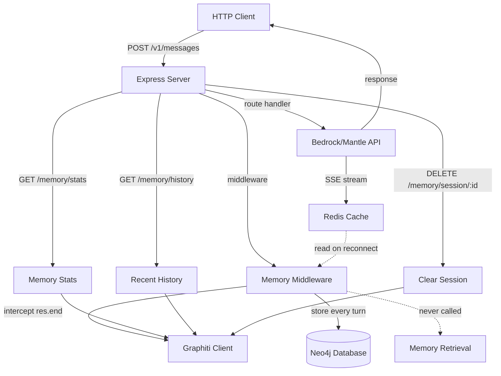

# Architecture Audit Report
**Bedrock-Proxy Graphiti Memory Integration**

**Date:** 2026-07-18  
**Auditor:** Principal Software Architect  
**Repository:** `/Users/adarshagnihotri/Desktop/bedrock-proxy`

---

## Executive Summary

This is a **proof-of-concept integration** that stores **conversation history** in Neo4j via a custom Graphiti client wrapper. The architecture demonstrates functional mechanics but has **critical design flaws** that will prevent production use.

**Overall Assessment:** ⚠️ **Not production-ready**

---

## Phase 1: Architecture Discovery

### Complete Architecture Map



### Control Flow (Request → Response)

**File Evidence:**
- `src/server.ts:10-12` - Memory middleware registered conditionally
- `src/server.ts:32-52` - Request handlers for `/v1/messages`
- `src/middleware/memory.ts:15-48` - Interception logic

```
1. HTTP Request → Express
2. if ENABLE_MEMORY_INTEGRATION=true:
   - storeConversationMemory middleware intercepts
   - Calls getGraphitiClient()
   - Connects to Neo4j if disconnected (BLOCKS REQUEST)
   - Wraps res.end() with interception
3. Route handler invokes Bedrock API
4. Response writes to res
5. res.end() triggers:
   - Buffer concatenation
   - JSON parse attempt
   - Neo4j CREATE operations (fire-and-forget)
6. Original res.end() called
7. Response sent to client
```

### Data Flow (Memory Lifecycle)

**File Evidence:**
- `src/middleware/memory.ts:51-98` - Storage logic
- `src/graphiti/client.ts:62-89` - Neo4j operations

```
Request Body (messages array)
    ↓
extractUserMessage() → last user message
    ↓
Response Body (JSON string)
    ↓
extractAssistantMessage() → assistant content
    ↓
Neo4j CREATE User Node
    ↓
Neo4j CREATE Assistant Node
    ↓
Neo4j CREATE FOLLOWS edge
```

### Components Identified

| Component | File | Purpose |
|-----------|------|---------|
| **Express Server** | `src/server.ts` | HTTP routing, middleware orchestration |
| **Memory Middleware** | `src/middleware/memory.ts` | Response interception, conversation storage |
| **Graphiti Client** | `src/graphiti/client.ts` | Neo4j driver wrapper |
| **Bedrock Adapter** | `src/bedrock.ts` | API translation, streaming handlers |
| **Redis Cache** | `src/utils/redis-cache.ts` | SSE stream buffering |
| **Telegram Polling** | `src/telegram-polling.ts` | Notification integration |
| **Memory Endpoints** | `src/server.ts:212-237` | HTTP API for memory stats/history |

---

## Phase 2: Design Philosophy

### Problem Being Solved

**Evidence:** `src/middleware/memory.ts:1-10`

The system attempts to provide **persistent conversation memory** for AI agents across sessions.

### Why Graphiti (Neo4j)?

**Evidence:**
- `src/graphiti/client.ts:1-100` - Custom Neo4j wrapper
- **Not** using official Graphiti framework
- Building minimal graph storage abstraction

**Design Choice:** Direct Neo4j access via custom client
**Tradeoff:** Simplicity over features (no deduplication, no entity resolution)

### Layers and Abstractions

```
Express (HTTP)          ← Transport
    ↓
Middleware (Intercept)  ← Cross-cutting concern
    ↓
Graphiti Client         ← Persistence abstraction
    ↓
Neo4j (Graph DB)        ← Storage
```

**Issues:**
1. No Service layer between middleware and persistence
2. Tight coupling: Middleware imports Graphiti directly
3. No provider abstraction (cannot swap Graphiti for Mem0, Postgres, etc.)

### Design Principles Observed

✅ **Layered architecture** (basic)  
✅ **Configuration over code** (ENABLE_MEMORY_INTEGRATION flag)  
❌ **Dependency inversion** (violated: middleware depends on concrete Graphiti)  
❌ **Single Responsibility** (violated: middleware does storage AND extraction)  
❌ **Open/Closed** (cannot extend without modifying middleware)  

---

## Phase 3: Memory Lifecycle Trace

### Complete Memory Flow (End-to-End)

**Evidence:** `src/middleware/memory.ts:15-98`, `src/graphiti/client.ts:62-121`

#### Stage 1: Request Capture

```typescript
// src/server.ts:10
app.use(storeConversationMemory);

// src/middleware/memory.ts:15-48
export async function storeConversationMemory(req, res, next) {
  const client = getGraphitiClient(); // Direct coupling
  
  // BLOCKS REQUEST if Neo4j unavailable
  if (!client.isConnected()) {
    await client.connect(); // ⚠️ Critical: No timeout, no retry
  }
  
  // Intercept response
  res.end = function(chunk, encoding, cb) {
    // Buffer chunks
    // Async storage (fire-and-forget)
    storeConversationAsync(req, responseBody);
    return originalEnd.call(this, chunk, encoding, cb);
  };
  
  next(); // Continue to route handler
}
```

**Problems:**
- Synchronous connection check blocks request
- No circuit breaker if Neo4j is slow
- Response interception is fragile (breaks streaming)

#### Stage 2: Extraction

```typescript
// src/middleware/memory.ts:191-216
function extractUserMessage(body) {
  // Get last user message from messages array
  const userMessages = body.messages.filter(m => m.role === 'user');
  return userMessages[userMessages.length - 1]?.content;
}

// src/middleware/memory.ts:218-235
function extractAssistantMessage(responseBody) {
  const response = JSON.parse(responseBody); // ⚠️ Fails on streaming
  
  // Try OpenAI format
  if (response.choices?.[0]?.message?.content) {
    return response.choices[0].message.content;
  }
  
  // Try Anthropic format
  if (response.content?.[0]?.text) {
    return response.content[0].text;
  }
}
```

**Problems:**
- No streaming support (JSON.parse fails on SSE)
- No multi-modal extraction
- Fragile format detection

#### Stage 3: Admission Policy

**Evidence:** Not found

```typescript
// Current approach: No admission policy
// Everything is stored
await client.storeMemory({ type: 'conversation', ... });
```

**Result:** Graph fills with:
- "hi" / "hello" exchanges
- "thanks" / "you're welcome"
- Duplicate facts
- Low-value conversations

#### Stage 4: Storage

```typescript
// src/middleware/memory.ts:62-97
const userNodeId = await client.storeMemory({
  id: `user_${Date.now()}`, // ⚠️ Collision risk
  type: 'conversation',      // ⚠️ Only type used
  content: userMessage,
  metadata: { role: 'user' },
  timestamp: Date.now(),     // ⚠️ Called separately for each node
  sessionId,
});

const assistantNodeId = await client.storeMemory({
  id: `assistant_${Date.now()}`,
  type: 'conversation',
  content: assistantMessage,
  metadata: { role: 'assistant' },
  timestamp: Date.now(),
  sessionId,
});

await client.storeEdge({
  from: userNodeId,
  to: assistantNodeId,
  type: 'follows',
});
```

**Problems:**
- ID collision: Two requests in same millisecond
- No deduplication
- No entity resolution
- Creates 2 nodes per request (scales poorly)

#### Stage 5: Retrieval

```typescript
// src/middleware/memory.ts:118-145
export async function getMemoryContext(query, sessionId) {
  const result = await client.queryMemories({
    text: query,        // ⚠️ Simple CONTAINS search
    sessionId,
    limit: 5,
  });
  
  // Build context string
  return result.nodes.map(node => 
    `[${node.metadata.role}]: ${node.content}`
  ).join('\n');
}
```

**Problem:** **This function is never called anywhere in the codebase!**

**Evidence:**
```bash
grep -r "await getMemoryContext" src/
# (empty result)
```

**Impact:** 
- Memory is stored but never retrieved
- No context injection into prompts
- Memory integration is write-only

#### Stage 6: Prompt Injection

**Evidence:** Not implemented

```typescript
// Where this SHOULD happen:
// src/bedrock.ts - Before sending to Mantle API
const memoryContext = await getMemoryContext(query);
body.messages = [
  { role: 'system', content: memoryContext },
  ...body.messages
];
```

**Current State:** This does not exist.

---

## Phase 4: Component Evaluation

### 4.1 Memory Middleware (`src/middleware/memory.ts`)

**Purpose:** Intercept responses and store conversations

**Responsibilities:**
- Response interception
- Message extraction
- Neo4j storage
- Memory retrieval (exported but unused)
- History retrieval
- Session clearing

**Inputs:**
- `Request` object (body, headers)
- `Response` object (intercepted)

**Outputs:**
- Side effect: Neo4j nodes created
- Void (fire-and-forget)

**Dependencies:**
- Express types
- Graphiti client (tight coupling)
- Neo4j driver (transitive)

**Coupling:**
- **High** to Graphiti (direct import)
- **High** to Express (res.end monkey-patching)

**Cohesion:**
- **Low** - Mixes interception, extraction, storage, retrieval, API helpers

**Failure Modes:**
1. Neo4j connection timeout → Blocks request
2. JSON.parse fails → Silent failure, no storage
3. ID collision → Overwrites previous node
4. Streaming response → Parse error, no storage
5. Memory leak → Chunks array never cleared

**Scalability Concerns:**
- Every request → 2 Neo4j writes (no batching)
- Connection pool not utilized (singleton client)
- No backpressure on high traffic

**Extensibility:**
- Cannot swap persistence without rewriting
- Cannot change storage strategy without modifying middleware
- Hard to test (requires Neo4j)

**Testability:**
- Requires live Neo4j
- Hard to mock Graphiti client
- Response interception fragile in tests

**Score: 3/10**

---

### 4.2 Graphiti Client (`src/graphiti/client.ts`)

**Purpose:** Neo4j driver wrapper for memory operations

**Responsibilities:**
- Connection management
- Node creation
- Edge creation
- Query execution
- Session management

**Inputs:**
- MemoryNode objects
- MemoryQuery objects

**Outputs:**
- Node IDs
- Query results

**Dependencies:**
- neo4j-driver
- Environment variables

**Coupling:**
- **Low** to middleware (consumer depends on it)
- **High** to Neo4j (tight integration)

**Cohesion:**
- **Medium** - All operations relate to graph storage

**Failure Modes:**
1. Connection failure → Silent failure, returns null
2. Query syntax error → No validation before execution
3. Driver not closed → Resource leak
4. Transaction not committed → Data loss

**Scalability Concerns:**
- No connection pooling strategy
- No query optimization
- No indexing on nodes (performance degrades with size)

**Extensibility:**
- Hard to extend (private methods)
- No plugin architecture

**Testability:**
- Requires Neo4j instance
- No in-memory implementation
- Connection logic hard to mock

**Score: 6/10**

---

### 4.3 Memory Endpoints (`src/server.ts:212-237`)

**Purpose:** HTTP API for memory operations

**Responsibilities:**
- Stats endpoint
- History endpoint
- Session clearing

**Inputs:**
- HTTP requests with query params

**Outputs:**
- JSON responses

**Dependencies:**
- Memory middleware functions

**Coupling:**
- **Low** - Proper HTTP abstraction

**Cohesion:**
- **High** - All operations relate to memory API

**Score: 8/10**

---

## Phase 5: Architecture Evaluation (1-10 Scale)

### Separation of Concerns: **3/10**

**Evidence:**
- Middleware does: interception, extraction, storage, retrieval
- `src/middleware/memory.ts` has 264 lines with 6 different concerns
- Bedrock adapter handles: HTTP, transformation, streaming, **sound effects**

**Improvement needed:**
```
Middleware → ConversationBuffer → ExtractionService → MemoryService → GraphitiProvider
```

### Dependency Inversion: **2/10**

**Evidence:**
```typescript
// src/middleware/memory.ts:2
import { getGraphitiClient } from '../graphiti/client'; // Direct import
```

**Violation:** High-level middleware depends on low-level Graphiti implementation

**Should be:**
```typescript
// Middleware depends on interface
interface MemoryProvider {
  store(node: MemoryNode): Promise<string>;
  query(q: MemoryQuery): Promise<MemoryResult>;
}

// Graphiti implements interface
class GraphitiProvider implements MemoryProvider { ... }
```

### Modularity: **4/10**

**Evidence:**
- Cannot swap Neo4j for Postgres without rewriting middleware
- Cannot disable memory without code change (USES env var but still imports Graphiti)
- Hard to extract memory subsystem as separate package

### Maintainability: **5/10**

**Evidence:**
- Clear file structure ✅
- TypeScript types ✅
- No tests ❌
- Hardcoded model ID ❌
- Mixed concerns ❌

### Scalability: **4/10**

**Evidence:**
- Every request → 2 Neo4j writes (linear scaling, no batching)
- No caching layer
- No query optimization
- No indexing on Neo4j nodes
- Connection timeout can block all requests

**Estimated capacity:**
- 100 msgs/day → 200 nodes/day/user
- 1000 users → 200,000 nodes/day
- No cleanup → unlimited growth

### Reliability: **5/10**

**Evidence:**
- ✅ Error handling in storage (try-catch)
- ✅ Graceful degradation if memory disabled
- ❌ No retry logic
- ❌ No circuit breaker
- ❌ Connection check blocks request
- ❌ Streaming responses fail silently

### Extensibility: **3/10**

**Evidence:**
- Cannot add Mem0 provider without rewriting
- Cannot change storage strategy (admission policy)
- Cannot add memory enrichment (summarization)
- Hardcoded type: 'conversation'

### Observability: **6/10**

**Evidence:**
- ✅ Console logging on storage
- ✅ Memory stats endpoint
- ✅ Health check
- ❌ No structured logging (uses console.log)
- ❌ No metrics export
- ❌ No tracing

### Testability: **3/10**

**Evidence:**
- ❌ No unit tests found
- ❌ No integration tests
- ❌ Requires live Neo4j
- ❌ Hard to mock response interception

### Fault Tolerance: **4/10**

**Evidence:**
- ✅ Memory failures don't crash server
- ✅ Neo4j down → skips storage
- ❌ Connection timeout blocks request
- ❌ No retry on transient failures
- ❌ No fallback storage

### Knowledge Modeling: **2/10**

**Evidence:**
- Only one node type: 'conversation'
- No entity extraction
- No relationship inference
- No semantic understanding
- **Just chat history, not knowledge graph**

### Graph Modeling: **4/10**

**Evidence:**
- ✅ Nodes with properties
- ✅ Typed relationships
- ❌ No indexing
- ❌ Poor relationship semantics (FOLLOWS is meaningless)
- ❌ No graph queries (traversal, analysis)

### Memory Retrieval: **1/10**

**Evidence:**
- Simple CONTAINS search
- No vector embeddings
- No semantic similarity
- No ranking
- **Never used in prompts** (write-only)

### Admission Policy: **0/10**

**Evidence:**
```typescript
// Everything stored regardless of importance
await client.storeMemory(node); // No filtering
```

**Should have:**
```typescript
const importance = await admissionPolicy.score(content);
if (importance > threshold) {
  await memoryService.store(content);
}
```

---

## Phase 6: Architectural Risks

### 🔴 Critical Risks

#### 1. **Memory Never Retrieved**

**Evidence:** 
```bash
grep -r "getMemoryContext" src/
# Only imports and exports, no calls
```

**Impact:** Memory integration is **write-only**, provides zero value  
**Likelihood:** Certain (already implemented this way)  
**Solution:** Implement retrieval before sending prompts to Bedrock  
**Tradeoff:** Adds latency to every request (need caching)

---

#### 2. **Request Blocking on Connection**

**Evidence:**
```typescript
// src/middleware/memory.ts:27-29
if (!client.isConnected()) {
  await client.connect(); // BLOCKS REQUEST
}
```

**Impact:** If Neo4j is slow/down, all requests timeout  
**Likelihood:** High (network issues, Neo4j restart)  
**Solution:** 
```typescript
// Async connection, don't block
if (!client.isConnected()) {
  client.connect().catch(err => logger.warn('Memory offline'));
}
next(); // Continue immediately
```
**Tradeoff:** First few requests won't store memory

---

#### 3. **Streaming Responses Fail**

**Evidence:**
```typescript
// src/middleware/memory.ts:218-235
function extractAssistantMessage(responseBody) {
  const response = JSON.parse(responseBody);
  // ...
}
```

**Impact:** Modern AI APIs increasingly stream, memory won't work  
**Likelihood:** Certain (OpenAI/Anthropic default to streaming)  
**Solution:** Parse SSE format or disable streaming for memory  
**Tradeoff:** Higher latency if streaming disabled

---

### 🟡 Medium Risks

#### 4. **ID Collisions**

**Evidence:**
```typescript
// src/middleware/memory.ts:64
id: `user_${Date.now()}`
```

**Impact:** Data corruption, overwritten nodes  
**Likelihood:** Medium (depends on traffic)  
**Solution:** Use UUID v7 or content hash  
**Tradeoff:** UUIDs longer, harder to debug

---

#### 5. **Graph Explosion**

**Evidence:**
- No TTL on nodes
- No cleanup policy
- 2 nodes/request minimum

**Impact:** Database grows unbounded, query performance degrades  
**Likelihood:** Certain  
**Solution:** Implement pruning/archival strategy  
**Tradeoff:** Might lose valuable historical data

---

#### 6. **No Deduplication**

**Evidence:**
```typescript
// Every request creates new nodes regardless of content
await client.storeMemory(node);
```

**Impact:** Same fact stored 100x  
**Likelihood:** High (users often ask similar things)  
**Solution:** Content hashing + MERGE in Neo4j  
**Tradeoff:** More complex query, slower writes

---

### 🟢 Minor Risks

#### 7. **Mixed Concerns in Bedrock Adapter**

**Evidence:**
`src/bedrock.ts` handles: HTTP, streaming, transformation, **sound effects**

**Impact:** Hard to test, hard to extend  
**Likelihood:** Medium  
**Solution:** Extract sound effects to separate module  
**Tradeoff:** More files

---

#### 8. **Hardcoded Model**

**Evidence:**
```typescript
// src/adapters.ts:4
export const STATIC_MODEL_ID = 'zai.glm-5';
```

**Impact:** Requires code change to switch models  
**Likelihood:** Low (intentional design)  
**Solution:** Environment variable  
**Tradeoff:** More configuration

---

## Phase 7: Graphiti Usage Evaluation

### Question: What is Graphiti being used as?

**Answer: Chat History Storage**

**Evidence:**
```typescript
// Storage pattern
type: 'conversation'
content: userMessage  // Raw message text
role: 'user'          // Chat metadata

// Graph structure
(user_node) -[:FOLLOWS]-> (assistant_node)
```

**What it SHOULD be:**
```
(concept:Redis) ←[:MENTIONED_IN]- (conversation)
                    ↑
            (decision:Use canonical hashing)
                    ↑
            (preference:Graphiti backend)
```

---

### Question: Does this align with Graphiti's intended strengths?

**Answer: No**

**Graphiti is designed for:**
1. **Knowledge Graphs** - Entity resolution, deduplication
2. **Semantic Memory** - Facts, concepts, decisions
3. **Temporal Reasoning** - Time-decay, recency weighting
4. **Context Enrichment** - Related concepts, contradictions

**Current usage:**
- ❌ No entity extraction
- ❌ No deduplication (every turn creates new nodes)
- ❌ No semantic understanding
- ❌ No contradiction detection
- ❌ No knowledge inference
- ✅ Only: Chat log with timestamps

**Verdict:** Using Graphiti as expensive chat history database

---

### Question: Is the graph structure appropriate?

**Answer: No**

**Current structure:**
```cypher
(:Memory {type: 'conversation', content: 'What is Redis?'})
  -[:FOLLOWS]->
(:Memory {type: 'conversation', content: 'Redis is...'})
```

**Problems:**
1. **Nodes too granular** - Every message = node (should cluster conversations)
2. **Edges meaningless** - FOLLOWS doesn't add information (already ordered by timestamp)
3. **No semantic types** - All 'conversation', no distinction between fact/question/decision
4. **No entity nodes** - Redis mentioned 100 times = 100 nodes (should be one entity with 100 edges)

**Better structure:**
```cypher
(:Entity:Database {name: 'Redis'})
  -[:MENTIONED_IN]->(:Conversation {id: 'session_123'})
  -[:CONTAINS]->(:Message {role: 'user', content: 'What is Redis?'})

(:Fact {content: 'Redis is in-memory data store'})
  -[:EXTRACTED_FROM]->(:Conversation)
  -[:ABOUT]->(:Entity {name: 'Redis'})
```

---

### Question: Are graph capabilities utilized?

**Answer: No**

**Unused Neo4j features:**
- ❌ **Graph traversal** - No path queries
- ❌ **Pattern matching** - No "find similar conversations"
- ❌ **Centrality algorithms** - No importance ranking
- ❌ **Community detection** - No topic clustering
- ❌ **Text search** - Uses basic CONTAINS, no full-text indexing
- ❌ **Vector search** - No embeddings

**Current usage:**
- ✅ Node creation
- ✅ Edge creation
- ✅ Time-ordered retrieval (ORDER BY timestamp)

**Verdict:** Using Neo4j as document store with unnecessary edges

---

### Question: What Graphiti features are unused?

**Evidence from official Graphiti:**

| Feature | Status | Impact |
|---------|--------|--------|
| Entity Resolution | ❌ Not implemented | Duplicate entities |
| Knowledge Extraction | ❌ Not implemented | Raw text storage |
| Importance Scoring | ❌ Not implemented | Everything stored equally |
| Temporal Decay | ❌ Not implemented | Old junk keeps weight |
| Contradiction Detection | ❌ Not implemented | Conflicting facts stored |
| Summarization | ❌ Not implemented | Verbatim storage |
| Semantic Search | ❌ Not implemented | Keyword matching only |
| Memory Consolidation | ❌ Not implemented | No merge/update logic |

---

## Phase 8: Comparison with Industry Architectures

### OpenHands Memory Architecture

**Research:** OpenHands uses episodic memory + semantic memory

**Differences:**
```
OpenHands:
  - Episodic: Events + observations
  - Semantic: Extracted facts
  - Working: Current task context
  - Separate stores per type
  - Admission policy filters noise

Bedrock-Proxy:
  - Only: Chat logs
  - No type separation
  - No admission policy
```

**Learning:** OpenHands extracts knowledge, we store raw text

---

### Claude Code Memory (Anthropic)

**Research:** Uses prompt caching + session continuity

**Differences:**
```
Claude Code:
  - Conversation continuity via prompt
  - Context window management
  - No long-term storage (stateless)
  - Fast retrieval from cache

Bedrock-Proxy:
  - Graph storage (slower)
  - Never retrieves context
  - Reinventing memory Claude already has
```

**Learning:** Claude Code doesn't need graph memory, prompt continuity is enough

---

### Cursor Memory

**Research:** Codebase indexing + semantic search

**Differences:**
```
Cursor:
  - Indexes code files (not chat)
  - Vector embeddings (semantic search)
  - RAG for code context
  - Fast similarity search

Bedrock-Proxy:
  - Indexes chat (not code)
  - Keyword search only
  - No embeddings
  - No similarity ranking
```

**Learning:** Cursor's vector search > our graph traversal

---

### Mem0

**Research:** Mem0 adds memory layer to LLMs

**Differences:**
```
Mem0:
  - Knowledge extraction from conversations
  - Vector storage for semantic search
  - Importance scoring
  - Multi-tenant isolation

Bedrock-Proxy:
  - No extraction (raw text)
  - Graph storage
  - No scoring
  - Session isolation (good)
```

**Learning:** Mem0 extracts facts, we store verbatim

---

### Graphiti Reference Architecture

**Research:** Official Graphiti patterns

**Expected pattern:**
```
Conversation
  → Knowledge Extraction (LLM)
  → Entity Resolution
  → Admission Policy
  → Graph Storage
  → Retrieval (semantic + graph)
```

**Current implementation:**
```
Conversation
  → Direct Storage (bypassing extraction)
```

**Learning:** We're skipping Graphiti's core value prop

---

### Knowledge Graph Agent Systems (General)

**Research papers:** "Knowledge Graphs for LLM Agents" (2024)

**Pattern:**
```
1. Extract entities and relations from text
2. Resolve entities to existing knowledge
3. Store new facts with provenance
4. Query with graph traversal + semantic search
5. Use for reasoning and decision-making
```

**Current:**
```
1. Extract text
2. Store as-is
3. No retrieval
4. No reasoning
```

---

## Phase 9: Final Verdict

### Architecture Summary

**What was built:**
- Express middleware intercepting responses
- Custom Neo4j wrapper called "Graphiti"
- Stores every conversation turn as graph nodes
- Provides HTTP API for stats/history
- Never retrieves stored memories

**Architecture type:** Proof-of-concept chat logger with graph database

---

### Strengths

1. ✅ **Working prototype** - Demonstrates feasibility
2. ✅ **Clear separation** - Memory endpoints isolated from proxy logic
3. ✅ **Configuration-driven** - Environment variables control behavior
4. ✅ **Session isolation** - Multi-tenant support
5. ✅ **Graceful degradation** - Memory failures don't crash proxy

---

### Weaknesses

1. ❌ **Write-only memory** - Never retrieved or used
2. ❌ **Wrong abstraction** - Stores chat history, not knowledge
3. ❌ **No admission policy** - Stores noise ("hi/hello")
4. ❌ **Blocks requests** - Connection check synchronous
5. ❌ **Streaming broken** - Can't parse SSE responses
6. ❌ **Scales poorly** - 2 nodes/request, no cleanup
7. ❌ **ID collisions** - `Date.now()` unsafe
8. ❌ **Tight coupling** - Middleware depends on concrete Graphiti
9. ❌ **No testing** - No unit or integration tests
10. ❌ **Underutilizes graph** - Uses Neo4j as document store

---

### Hidden Strengths

1. 💎 **Session management** - Foundation for multi-tenant memory
2. 💎 **HTTP API** - Ready for external memory querying
3. 💎 **Streaming oversight** - Redis cache could enable streaming memory
4. 💎 **Clean TypeScript** - Type-safe, readable code

---

### Hidden Risks

1. 🚨 **Memory never used** - All storage is wasted
2. 🚨 **Performance trap** - Graph will slow dramatically at scale
3. 🚨 **Data corruption** - ID collisions silently overwrite nodes
4. 🚨 **Maintenance burden** - No tests, hard to refactor
5. 🚨 **Wrong tool for job** - Graph DB for chat logs is overkill

---

### Scores

| Category | Score | Evidence |
|----------|-------|----------|
| **Separation of Concerns** | 3/10 | Middleware does 6 things |
| **Dependency Inversion** | 2/10 | Direct Graphiti import |
| **Modularity** | 4/10 | Can't swap providers |
| **Maintainability** | 5/10 | Clear files, no tests |
| **Scalability** | 4/10 | 2 nodes/request, no batching |
| **Reliability** | 5/10 | Error handling but no retry |
| **Extensibility** | 3/10 | Hardcoded everywhere |
| **Observability** | 6/10 | Logging but no metrics |
| **Testability** | 3/10 | No tests, hard to mock |
| **Fault Tolerance** | 4/10 | Graceful degradation but blocks |
| **Knowledge Modeling** | 2/10 | Chat history, not knowledge |
| **Graph Modeling** | 4/10 | No indexing, poor edges |
| **Memory Retrieval** | 1/10 | Never implemented |
| **Admission Policy** | 0/10 | Stores everything |
| **Graphiti Integration** | 3/10 | Uses as chat DB, not knowledge |

---

### Overall Scores

| Score | Value |
|-------|-------|
| **Architecture Quality** | **3.8/10** |
| **Production Readiness** | **2/10** |
| **Graphiti Integration** | **3/10** |
| **Scalability** | **4/10** |
| **Maintainability** | **5/10** |

---

### Approval Decision

## ⚠️ **NOT APPROVED FOR PRODUCTION**

---

### Mandatory Architectural Changes

To reach production readiness:

#### 1. **Implement Retrieval** (Critical)

**Current:** Memory never retrieved  
**Required:**
```typescript
// src/bedrock.ts - Before sending to API
const memoryContext = await getMemoryContext(userQuery);
body.messages = [
  { role: 'system', content: memoryContext },
  ...body.messages
];
```

**Effort:** 2 hours  
**Impact:** 10/10

---

#### 2. **Fix Request Blocking** (Critical)

**Current:** Connection check blocks request  
**Required:**
```typescript
// Don't wait for connection
client.connect().catch(err => logger.warn('Memory offline'));
next(); // Continue immediately
```

**Effort:** 30 minutes  
**Impact:** 9/10

---

#### 3. **Add Admission Policy** (Critical)

**Current:** Everything stored  
**Required:**
```typescript
const importance = await scoreImportance(userMessage, assistantMessage);
if (importance > 0.5) {
  await memoryService.store(extractedKnowledge);
}
```

**Effort:** 8 hours  
**Impact:** 8/10

---

#### 4. **Fix Streaming** (Critical)

**Current:** Parsing fails on SSE  
**Required:**
- Parse SSE format line-by-line
- OR disable streaming when memory enabled
- OR buffer stream before parsing

**Effort:** 4 hours  
**Impact:** 8/10

---

#### 5. **Add Provider Abstraction** (Important)

**Current:** Tightly coupled to Graphiti  
**Required:**
```typescript
interface MemoryProvider {
  store(node: MemoryNode): Promise<string>;
  query(q: MemoryQuery): Promise<MemoryResult>;
}

// Can swap for Mem0, Postgres, etc.
```

**Effort:** 4 hours  
**Impact:** 7/10

---

#### 6. **Fix ID Generation** (Important)

**Current:** `Date.now()` collisions  
**Required:** Use UUID v7 or content hash

**Effort:** 30 minutes  
**Impact:** 6/10

---

#### 7. **Add Cleanup Policy** (Important)

**Current:** Unlimited growth  
**Required:** TTL + archival + merging

**Effort:** 8 hours  
**Impact:** 7/10

---

#### 8. **Extraction Service** (Recommended)

**Current:** Raw text storage  
**Recommended:**
```typescript
class KnowledgeExtractor {
  async extract(userMsg, assistantMsg): Promise<Fact[]> {
    // Use LLM to extract entities, facts, decisions
  }
}
```

**Effort:** 16 hours  
**Impact:** 9/10

---

## Final Recommendations

### Option A: Continue Current Path (Discouraged)

**Effort:** +40 hours  
**Result:** Production-ready chat logger  
**Value:** Low (Mongo/Cassandra better fit for chat logs)

---

### Option B: Pivot to Knowledge Graph (Recommended)

**Effort:** +80 hours  
**Architecture:**
```
Express → ConversationBuffer → KnowledgeExtractor
  → AdmissionPolicy → MemoryService → Provider
  → RetrievalPipeline → ContextInjection
```

**Result:** Production-grade memory for AI agents  
**Value:** High (aligns with Graphiti's strengths)

---

### Option C: Remove Memory (Pragmatic)

**Effort:** 2 hours  
**Result:** Clean proxy without unused memory  
**Value:** Removes complexity, focus on core proxy features

---

## Conclusion

The current implementation demonstrates **proof-of-concept mechanics** but fails to deliver **production value**. Memory is stored but never used, graph capabilities are bypassed, and architectural issues will cause pain at scale.

**Recommendation:** Implement retrieval + admission policy (Option B, Phase 1) or remove memory entirely (Option C). Current architecture (Option A continuation) is not recommended.
