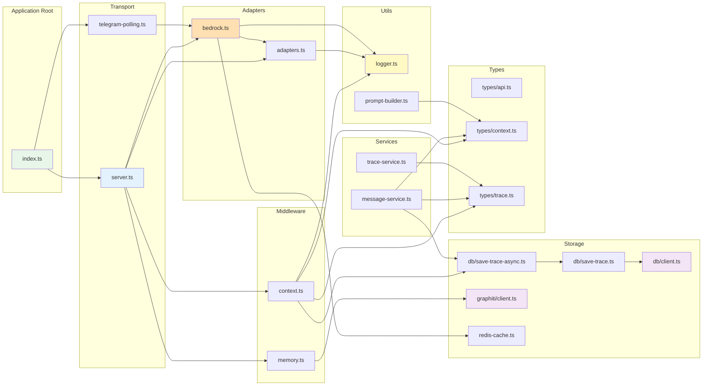

# Bedrock Proxy - Architecture Discovery Report

**Date**: 2026-07-18  
**Phase**: 1 - Discover the Architecture  
**Method**: Source Code Analysis (Evidence-Based)

---

## 1. Complete File Listing with Purpose

### Entry Point
| File | Lines | Purpose |
|------|-------|---------|
| `src/index.ts` | 1-37 | **Application Bootstrap** - Starts Express server + Telegram polling, auto-setup memory hooks, graceful shutdown handlers |

### Core Server Layer
| File | Lines | Purpose |
|------|-------|---------|
| `src/server.ts` | 1-245 | **HTTP Transport Layer** - Express routes, request handling, endpoint definitions (Anthropic, OpenAI, Legacy, Responses APIs) |
| `src/bedrock.ts` | 1-452 | **External Integration Layer** - Mantle HTTP client, adapter transformations (Anthropic↔OpenAI), streaming SSE handling |
| `src/adapters.ts` | 1-250 | **Shape Transformation Layer** - Pure functions converting between Anthropic, OpenAI, and AWS Bedrock Converse API formats |
| `src/telegram-polling.ts` | 1-339 | **Background Worker** - Telegram bot integration for notifications, long polling mechanism |

### Middleware Layer
| File | Lines | Purpose |
|------|-------|---------|
| `src/middleware/memory.ts` | 1-264 | **Memory Storage Middleware** - Intercepts HTTP responses, extracts conversations, stores to Graphiti/Neo4j |
| `src/middleware/context.ts` | 1-92 | **Request Context Middleware** - Generates trace_id, classifies route types, attaches ExecutionContext to requests |

### Services Layer
| File | Lines | Purpose |
|------|-------|---------|
| `src/services/message-service.ts` | 1-127 | **Message Processing Orchestration** - Routes to appropriate adapters, manages trace persistence |
| `src/services/trace-service.ts` | 1-146 | **Trace Management Service** - Ingests/retrieves execution traces from PostgreSQL |

### Graphiti Memory Integration
| File | Lines | Purpose |
|------|-------|---------|
| `src/graphiti/client.ts` | 1-250+ | **Neo4j Graph Database Client** - Stores/retrieves conversation memories as graph nodes/edges |

### Database Layer
| File | Lines | Purpose |
|------|-------|---------|
| `src/db/client.ts` | 1-65 | **PostgreSQL Connection Pool** - pg Pool singleton, connection management |
| `src/db/save-trace.ts` | 1-51 | **Sync Trace Persistence** - Direct INSERT to execution_traces table |
| `src/db/save-trace-async.ts` | 1-24 | **Async Trace Persistence** - Fire-and-forget pattern using setImmediate() |

### Utilities Layer
| File | Lines | Purpose |
|------|-------|---------|
| `src/utils/logger.ts` | 1-79 | **Structured Logging** - Winston logger with trace_id injection, context-aware |
| `src/utils/prompt-builder.ts` | 1-75 | **Prompt Assembly** - Simple message array construction (Phase 1: no policy logic) |
| `src/utils/redis-cache.ts` | 1-150+ | **Streaming Response Cache** - Redis-based buffering for SSE streams, batch writes |

### Type Definitions
| File | Lines | Purpose |
|------|-------|---------|
| `src/types/api.ts` | 1-104 | **API Contracts** - Request/response type guards for Anthropic, OpenAI, Legacy APIs |
| `src/types/context.ts` | 1-54 | **ExecutionContext** - Trace metadata, route classification types |
| `src/types/trace.ts` | 1-120+ | **ExecutionTrace** - Server-internal tracing, StageRecord, ExecutionTraceBuilder class |

---

## 2. Architecture Diagram (Mermaid)

```mermaid
graph TB
    subgraph "Client Layer"
        CC[Claude Code / VS Code]
        TG[Telegram Bot API]
    end

    subgraph "Transport Layer"
        EX[Express HTTP Server<br/>src/server.ts]
        TP[Telegram Polling Worker<br/>src/telegram-polling.ts]
    end

    subgraph "Middleware Layer"
        MC[Context Middleware<br/>src/middleware/context.ts]
        MM[Memory Middleware<br/>src/middleware/memory.ts]
    end

    subgraph "Services Layer"
        MS[Message Service<br/>src/services/message-service.ts]
        TS[Trace Service<br/>src/services/trace-service.ts]
    end

    subgraph "Adapter Layer"
        AD[Shape Adapters<br/>src/adapters.ts]
        BD[Mantle Client<br/>src/bedrock.ts]
    end

    subgraph "Storage Layer"
        PG[(PostgreSQL<br/>execution_traces)]
        NX[(Neo4j<br/>graphiti/memory)]
        RD[(Redis<br/>stream cache)]
    end

    subgraph "External APIs"
        MT[AWS Bedrock Mantle<br/>https://bedrock-mantle.{region}.api.aws]
    end

    subgraph "Utilities"
        LG[Logger<br/>src/utils/logger.ts]
        PB[Prompt Builder<br/>src/utils/prompt-builder.ts]
        RC[Redis Cache<br/>src/utils/redis-cache.ts]
    end

    %% Request Flow
    CC -->|HTTP Request| EX
    EX -->|Attach Context| MC
    MC -->|Intercept Response| MM
    MM -->|Route| MS
    
    %% Message Processing
    MS -->|Anthropic/OpenAI| AD
    AD -->|Transform| BD
    BD -->|HTTPS POST| MT
    MT -->|SSE Stream| BD
    BD -->|Transform Response| AD
    AD -->|Return| MS
    MS -->|Response| EX
    EX -->|HTTP Response| CC

    %% Async Persistence
    MC -.->|saveTraceAsync| TS
    TS -.->|INSERT| PG
    MM -.->|storeMemory| NX

    %% Telegram Integration
    TP -->|Poll Updates| TG
    TP -->|Notify Completion| TG
    TG -.->|User Message| TP
    TP -->|invokeModelOpenAI| BD

    %% Caching
    BD -->|Stream Chunks| RC
    RC -->|Batch Write| RD

    %% Utilities
    MC -.->|Context Logger| LG
    MS -.->|Build Prompt| PB

    style EX fill:#4A90E2
    style BD fill:#E24A4A
    style MT fill:#F5A623
    style PG fill:#50C878
    style NX fill:#9B59B6
    style RD fill:#E67E22
```

---

## 3. Control Flow Description

### Request Flow (Synchronous Path)

**File Evidence**: `src/server.ts:62-78`, `src/bedrock.ts:1-452`

1. **Entry** (`src/index.ts:7-10`)
   - Express server starts on PORT (default: 3000)
   - Telegram polling starts in background
   - Memory auto-setup attempted (optional)

2. **Request Ingress** (`src/server.ts:30-47`)
   - Traffic logger middleware logs incoming request (method, URL, IP, body preview)
   - Health check (`GET /health`) returns immediately
   - Model list (`GET /v1/models`) returns static AVAILABLE_MODELS

3. **Route Classification** (`src/server.ts:62-215`)
   - **Anthropic Messages API**: `POST /v1/messages` (line 62)
   - **OpenAI Chat Completions**: `POST /v1/chat/completions` (line 148)
   - **Legacy Completions**: `POST /v1/completions` (line 104)
   - **Responses API**: `POST /v1/responses` (line 180)

4. **Streaming Decision** (`src/server.ts:66-67`)
   - Check `body['stream'] === true`
   - Branch to streaming vs sync handlers

5. **Adapter Invocation** (`src/bedrock.ts:1-452`)
   - **Case A**: Native Anthropic model → Direct Mantle call
   - **Case B**: Non-Anthropic model (OpenAI surface) → Transform → Mantle → Transform back

6. **Response Delivery** (`src/server.ts:72-91`)
   - Sync: Return JSON response + play sound notification
   - Stream: SSE events streamed to client + sound on completion

### Streaming Flow (SSE)

**File Evidence**: `src/bedrock.ts:220-340`

1. **Request Transformation** (`src/bedrock.ts:39-122`)
   - `anthropicBodyToOpenAI()` converts Anthropic Messages → OpenAI Chat Completions format
   - Maps system messages, tool_use blocks, tool_result blocks

2. **Mantle HTTP Request** (`src/bedrock.ts:290-330`)
   - POST to `${MANTLE_BASE_URL}/v1/chat/completions`
   - Headers: `Authorization: Bearer ${MANTLE_API_KEY}`
   - Streaming enabled: `stream: true`

3. **SSE Event Transformation** (`src/bedrock.ts:220-340`)
   - Read OpenAI-format SSE stream from Mantle
   - Convert each chunk to Anthropic-format SSE event:
     - `message_start` → Initialize message object
     - `content_block_start` → Start text/tool_use block
     - `content_block_delta` → Stream text/input_json
     - `content_block_stop` → End block
     - `message_delta` → Final stop_reason + usage
     - `message_stop` → End message

4. **Redis Caching** (`src/utils/redis-cache.ts:50-100`)
   - Buffer SSE chunks (max 100 chunks or 2s interval)
   - Batch write to Redis: `RPUSH bedrock:stream:{requestId} {chunk}`
   - Set TTL (default: 3600s)

5. **Telegram Notification** (`src/bedrock.ts:440-452`)
   - On completion, send response to Telegram (if configured)
   - Truncate to 4000 chars

### Telegram Polling Flow (Background Worker)

**File Evidence**: `src/telegram-polling.ts:1-339`

1. **Poll Loop** (`src/telegram-polling.ts:59-127`)
   - GET `api.telegram.org/bot{TOKEN}/getUpdates?offset={lastUpdateId+1}&timeout=30`
   - Long polling (30s timeout)
   - Retry on network errors (max 3x)

2. **Message Processing** (`src/telegram-polling.ts:140-180`)
   - Extract user message from update
   - Check availability (5-minute cache)
   - Maintain message history (10 messages)
   - Forward to `invokeModelOpenAI()`

3. **Response Handling** (`src/telegram-polling.ts:182-220`)
   - Send result back via Telegram API
   - Rate-limited error logging (1/min)

4. **Graceful Shutdown** (`src/index.ts:30-37`)
   - SIGINT/SIGTERM handlers
   - Exit cleanly

---

## 4. Data Flow Description

### Trace Data Flow

**File Evidence**: `src/middleware/context.ts:60-92`, `src/db/save-trace-async.ts:1-24`

```
Request → ContextMiddleware → ExecutionContext → ExecutionTraceBuilder
           ↓                                          ↓
       req.context                               req.trace
           ↓                                          ↓
       res.on('finish') ──────────────────────→ trace.complete()
                                                      ↓
                                               ExecutionTraceRow
                                                      ↓
                                               saveTraceAsync()
                                                      ↓
                                               setImmediate()
                                                      ↓
                                               PostgreSQL INSERT
                                                      ↓
                                             execution_traces table
```

**Data Structure** (`src/types/trace.ts:29-38`):
```typescript
{
  trace_id: string,          // UUID v4
  route: string,             // 'anthropic' | 'openai' | 'legacy'
  routing_ms: number,        // Stage timing
  prompt_build_ms: number,   // Stage timing
  adapter_ms: number,        // Stage timing
  total_ms: number,          // Total request time
  status: string,            // 'success' | 'error' | 'timeout'
  error_message: string,     // Error details
  project_root: string       // Project context
}
```

**Persistence Pattern**: Fire-and-forget (non-blocking)
- Uses `setImmediate()` to avoid blocking event loop
- Failures logged but never thrown
- Request never waits for DB

### Memory Data Flow (Graphiti)

**File Evidence**: `src/middleware/memory.ts:1-264`, `src/graphiti/client.ts:1-250`

```
HTTP Response → storeConversationMemory middleware
                     ↓
         Intercept res.end() → Buffer response chunks
                     ↓
         Response complete → Extract messages
                     ↓
         ┌─────────────────┴─────────────────┐
         ↓                                   ↓
   User Message Node                  Assistant Message Node
   (id: user_{ts})                    (id: assistant_{ts})
         ↓                                   ↓
   Neo4j CREATE                      Neo4j CREATE
         ↓                                   ↓
         └─────────────→ FOLLOWS Edge ←─────┘
                              ↓
                     Graph Structure:
                     (User)-[:FOLLOWS]->(Assistant)
```

**Query Flow**:
```
Client Request → getMemoryContext(query, sessionId)
                       ↓
              GraphitiClient.queryMemories()
                       ↓
              Cypher: MATCH (n:Memory)
                      WHERE n.content CONTAINS $text
                      AND n.sessionId = $sessionId
                      ORDER BY n.timestamp DESC
                      LIMIT $limit
                       ↓
              MemoryResult { nodes, edges, relevanceScore }
                       ↓
              Context String: "\n\n[Memory Context]\n[user]: ...\n[assistant]: ..."
```

**Storage Schema** (`src/graphiti/client.ts:27-38`):
```cypher
CREATE (n:Memory {
  id: $id,
  type: $type,              // 'conversation' | 'concept' | 'decision' | 'preference'
  content: $content,
  metadata: $metadata,      // { role, model, tokens }
  timestamp: $timestamp,
  sessionId: $sessionId,
  createdAt: datetime()
})
```

### Adapter Data Flow (Request Transformation)

**File Evidence**: `src/adapters.ts:1-250`, `src/bedrock.ts:39-122`

**Anthropic → OpenAI** (`src/bedrock.ts:39-122`):
```
Anthropic Request:
{
  system: "string",
  messages: [
    { role: "user", content: [{ type: "text", text: "..." }] },
    { role: "assistant", content: [{ type: "tool_use", name: "...", input: {...} }] }
  ],
  tools: [{ name, description, input_schema }],
  max_tokens: 1024,
  temperature: 0.7
}
         ↓ anthropicBodyToOpenAI()
OpenAI Request:
{
  model: "zai.glm-5",
  messages: [
    { role: "system", content: "string" },
    { role: "user", content: "..." },
    { role: "assistant", tool_calls: [{ id, type: "function", function: { name, arguments } }] }
  ],
  tools: [{ type: "function", function: { name, description, parameters } }],
  max_tokens: 1024,
  temperature: 0.7
}
```

**OpenAI → Anthropic Response** (`src/bedrock.ts:124-148`):
```
OpenAI Response:
{
  choices: [{
    message: {
      content: "...",
      tool_calls: [{ id, function: { name, arguments } }]
    },
    finish_reason: "stop"
  }],
  usage: { prompt_tokens: 10, completion_tokens: 20 }
}
         ↓ openAIResponseToAnthropic()
Anthropic Response:
{
  id: "msg_123",
  type: "message",
  role: "assistant",
  content: [
    { type: "text", text: "..." },
    { type: "tool_use", id: "...", name: "...", input: {...} }
  ],
  model: "zai.glm-5",
  stop_reason: "end_turn",
  usage: { input_tokens: 10, output_tokens: 20 }
}
```

---

## 5. Memory Lifecycle Description

### Memory Creation Lifecycle

**File Evidence**: `src/middleware/memory.ts:20-108`

```
┌─────────────────────────────────────────────────────────────────┐
│ 1. REQUEST ARRIVAL                                              │
│    - Memory middleware checks ENABLE_MEMORY_INTEGRATION        │
│    - Skips if disabled (line 22-24)                            │
└─────────────────────────────────────────────────────────────────┘
                           ↓
┌─────────────────────────────────────────────────────────────────┐
│ 2. RESPONSE INTERCEPTION                                        │
│    - Store original res.end() (line 32)                         │
│    - Intercept and buffer all chunks (line 36-39)               │
└─────────────────────────────────────────────────────────────────┘
                           ↓
┌─────────────────────────────────────────────────────────────────┐
│ 3. MESSAGE EXTRACTION                                           │
│    - Extract user message from req.body (line 55-61)           │
│    - Extract assistant message from response body (line 68-77) │
│    - Parse JSON response, handle both text and tool_use        │
└─────────────────────────────────────────────────────────────────┘
                           ↓
┌─────────────────────────────────────────────────────────────────┐
│ 4. NODE CREATION (Neo4j)                                        │
│    - User Node:                                                 │
│      { id: "user_{timestamp}",                                 │
│        type: "conversation",                                   │
│        content: "...",                                         │
│        metadata: { role: "user", model: "..." },              │
│        sessionId: "default" }                                  │
│    - Assistant Node:                                            │
│      { id: "assistant_{timestamp}",                            │
│        type: "conversation",                                   │
│        content: "...",                                         │
│        metadata: { role: "assistant", tokens: 100 },         │
│        sessionId: "default" }                                  │
└─────────────────────────────────────────────────────────────────┘
                           ↓
┌─────────────────────────────────────────────────────────────────┐
│ 5. EDGE CREATION (Graph Relationship)                          │
│    - CREATE (user)-[:FOLLOWS { weight: 1.0 }]->(assistant)    │
│    - Links conversation turns in sequence                       │
└─────────────────────────────────────────────────────────────────┘
                           ↓
┌─────────────────────────────────────────────────────────────────┐
│ 6. CONFIRMATION                                                 │
│    - Console log: "✓ Stored conversation in Graphiti memory"   │
│    - Errors handled gracefully (line 87-89)                    │
└─────────────────────────────────────────────────────────────────┘
```

### Memory Retrieval Lifecycle

**File Evidence**: `src/middleware/memory.ts:93-145`

```
┌─────────────────────────────────────────────────────────────────┐
│ 1. QUERY REQUEST                                                │
│    - Input: query string, optional sessionId                    │
│    - Example: "What did the user ask about pricing?"           │
└─────────────────────────────────────────────────────────────────┘
                           ↓
┌─────────────────────────────────────────────────────────────────┐
│ 2. NEO4J CYPHER QUERY                                          │
│    MATCH (n:Memory)                                            │
│    WHERE n.content CONTAINS $text                               │
│    AND n.sessionId = $sessionId                                 │
│    WITH n ORDER BY n.timestamp DESC                             │
│    LIMIT 5                                                      │
│    OPTIONAL MATCH (n)-[r]-(m:Memory)                           │
│    RETURN n, collect({edge: r, node: m}) as related           │
└─────────────────────────────────────────────────────────────────┘
                           ↓
┌─────────────────────────────────────────────────────────────────┐
│ 3. RESULT TRANSFORMATION                                        │
│    - Extract nodes from Neo4j records                          │
│    - Extract edges from related entities                        │
│    - Deduplicate nodes/edges                                    │
│    - Return: { nodes, edges, relevanceScore }                 │
└─────────────────────────────────────────────────────────────────┘
                           ↓
┌─────────────────────────────────────────────────────────────────┐
│ 4. CONTEXT STRING BUILDING                                      │
│    - Format each node as: "[{role}]: {content}"                │
│    - Join with newlines                                         │
│    - Return: "\n\n[Memory Context]\n{formatted nodes}\n"      │
└─────────────────────────────────────────────────────────────────┘
```

### Memory Session Management

**File Evidence**: `src/middleware/memory.ts:166-188`

```
Clear Session:
  - Input: sessionId
  - Cypher: MATCH (n:Memory {sessionId: $sessionId}) DETACH DELETE n
  - Removes all nodes and edges in session

Get Stats:
  - Return: { nodeCount: number, edgeCount: number }
  - Aggregates across all sessions
```

### Memory Queries Available

**File Evidence**: `src/middleware/memory.ts:93-188`

1. **`getMemoryContext(query, sessionId?)`**
   - Search-based retrieval (contains text)
   - Returns formatted context string
   - Used for: Injecting past context into prompts

2. **`getRecentHistory(limit, sessionId?)`**
   - Time-based retrieval (ORDER BY timestamp DESC)
   - Returns array of MemoryNode
   - Used for: Viewing conversation history

3. **`clearMemorySession(sessionId)`**
   - Delete all nodes/edges for session
   - Used for: Resetting conversation state

4. **`getMemoryStats()`**
   - Aggregate counts across all sessions
   - Used for: Monitoring memory usage

---

## 6. Integration Points

### External Dependencies

**File Evidence**: `package.json:15-26`

1. **AWS Bedrock Mantle**
   - Endpoint: `https://bedrock-mantle.{region}.api.aws`
   - Auth: Bearer token (`BEDROCK_MANTLE_API_KEY`)
   - Protocol: HTTP REST API (OpenAI-compatible surface)
   - Models: `zai.glm-5`, `anthropic.*`, others

2. **Neo4j Graph Database**
   - Driver: `neo4j-driver@6.2.0`
   - Connection: `bolt://localhost:7687`
   - Auth: Basic auth (`NEO4J_USER`, `NEO4J_PASSWORD`)
   - Purpose: Conversation memory graph storage

3. **PostgreSQL**
   - Driver: `pg@8.22.0`
   - Connection: `DATABASE_URL` env var
   - Purpose: Execution trace persistence
   - Table: `execution_traces` (migrations/001_create_execution_traces.sql)

4. **Redis**
   - Driver: `ioredis@5.11.1`
   - Connection: `REDIS_URL` env var
   - Purpose: Streaming response cache (batch write, TTL 3600s)

5. **Telegram Bot API**
   - Protocol: HTTPS REST
   - Auth: `TELEGRAM_BOT_TOKEN`, `TELEGRAM_CHAT_ID`
   - Purpose: Asynchronous notifications

### Configuration Boundaries

**File Evidence**: `src/index.ts:5-20`

| Environment Variable | Default | Purpose | Layer |
|---------------------|---------|---------|-------|
| `PORT` | 3000 | HTTP server port | Transport |
| `AWS_REGION` | `ap-south-1` | Bedrock Mantle region | Adapter |
| `BEDROCK_MANTLE_API_KEY` | Required | Auth for Mantle | Adapter |
| `ENABLE_MEMORY_INTEGRATION` | `false` | Toggle Graphiti memory | Middleware |
| `NEO4J_URI` | `bolt://localhost:7687` | Graph DB endpoint | Storage |
| `NEO4J_USER` | `neo4j` | Graph DB user | Storage |
| `NEO4J_PASSWORD` | `test1234` | Graph DB password | Storage |
| `DATABASE_URL` | None | PostgreSQL connection string | Storage |
| `REDIS_URL` | None | Redis connection string | Storage |
| `REDIS_STREAM_PREFIX` | `bedrock:stream:` | Redis key prefix | Storage |
| `REDIS_CACHE_TTL` | `3600` | Redis TTL (seconds) | Storage |
| `TELEGRAM_BOT_TOKEN` | None | Telegram bot auth | Integration |
| `TELEGRAM_CHAT_ID` | None | Telegram chat ID | Integration |
| `TELEGRAM_ENABLED` | `true` | Toggle notifications | Integration |
| `LOG_LEVEL` | `info` | Winston log level | Utility |

---

## 7. Abstractions and Boundaries

### Architectural Layers (Dependency Direction)

```
┌─────────────────────────────────────────────────────────────┐
│  CLIENT LAYER (External)                                    │
│  - Claude Code, VS Code, Telegram                           │
└─────────────────────────────────────────────────────────────┘
                         ↓ Calls
┌─────────────────────────────────────────────────────────────┐
│  TRANSPORT LAYER (HTTP)                                     │
│  - src/server.ts: Express routes, request handling          │
│  - src/telegram-polling.ts: Background worker               │
│  - Boundary: HTTP protocol, Express Request/Response        │
└─────────────────────────────────────────────────────────────┘
                         ↓ Invokes
┌─────────────────────────────────────────────────────────────┐
│  MIDDLEWARE LAYER (Cross-Cutting)                           │
│  - src/middleware/context.ts: Trace context                 │
│  - src/middleware/memory.ts: Memory interception            │
│  - Boundary: Express middleware chain (req, res, next)      │
└─────────────────────────────────────────────────────────────┘
                         ↓ Routes to
┌─────────────────────────────────────────────────────────────┐
│  SERVICE LAYER (Business Logic)                             │
│  - src/services/message-service.ts: Message orchestration  │
│  - src/services/trace-service.ts: Trace management          │
│  - Boundary: Service interfaces, dependency injection       │
└─────────────────────────────────────────────────────────────┘
                         ↓ Uses
┌─────────────────────────────────────────────────────────────┐
│  ADAPTER LAYER (Integration)                                │
│  - src/adapters.ts: Shape transformations                   │
│  - src/bedrock.ts: Mantle HTTP client                       │
│  - Boundary: Adapter functions, external HTTP               │
└─────────────────────────────────────────────────────────────┘
                         ↓ Persists to
┌─────────────────────────────────────────────────────────────┐
│  STORAGE LAYER (Data)                                       │
│  - src/db/: PostgreSQL (traces)                             │
│  - src/graphiti/: Neo4j (memory graphs)                    │
│  - src/utils/redis-cache.ts: Redis (stream cache)          │
│  - Boundary: Database protocols (pg, bolt, redis)          │
└─────────────────────────────────────────────────────────────┘
                         ↓ Uses
┌─────────────────────────────────────────────────────────────┐
│  UTILITY LAYER (Shared)                                     │
│  - src/utils/logger.ts: Structured logging                  │
│  - src/utils/prompt-builder.ts: Prompt assembly             │
│  - Boundary: Pure utility functions, no side effects        │
└─────────────────────────────────────────────────────────────┘
```

### Key Abstractions

**File Evidence**: `src/services/message-service.ts:19-32`, `src/types/context.ts:10-23`

1. **`ExecutionContext`**
   - Abstracts: Request metadata (trace_id, route, timestamp)
   - Created by: `contextMiddleware`
   - Used by: All middlewares, services, utils

2. **`ExecutionTraceBuilder`**
   - Abstracts: Timing measurement (stages, duration)
   - Pattern: Builder pattern with start/end/complete
   - Purpose: Performance monitoring

3. **`MessageService`**
   - Abstracts: Message processing workflow
   - Pattern: Factory function with dependency injection
   - Purpose: Orchestrate adapter selection + persistence

4. **`GraphitiClient`**
   - Abstracts: Graph database operations
   - Pattern: Singleton client with connect/disconnect
   - Purpose: Memory storage/retrieval

5. **Adapter Functions** (`src/adapters.ts`)
   - Abstracts: Protocol translation (Anthropic ↔ OpenAI ↔ Bedrock)
   - Pattern: Pure functions (no state)
   - Purpose: Shape transformation

### Boundaries (Coupling Points)

**File Evidence**: `src/server.ts`, `src/bedrock.ts`

1. **Transport-Service Boundary**
   - `server.ts` → `message-service.ts`
   - Coupling: Service interfaces (MessageService, TraceService)
   - Direction: Unidirectional (transport depends on service)

2. **Service-Storage Boundary**
   - `message-service.ts` → `db/save-trace-async.ts`
   - `middleware/memory.ts` → `graphiti/client.ts`
   - Coupling: Repository functions (saveTraceAsync, storeMemory)
   - Direction: Unidirectional (service depends on storage)

3. **Service-Adapter Boundary**
   - `message-service.ts` → `adapters.ts`, `bedrock.ts`
   - Coupling: Adapter functions (invokeModel, invokeModelStream)
   - Direction: Unidirectional (service depends on adapter)

4. **Middleware-Service Boundary**
   - `middleware/memory.ts` → (no service layer)
   - **VIOLATION**: Directly calls Graphiti client (skip-layer)
   - Fixed in: `message-service.ts` (proper layering)

5. **Adapter-External Boundary**
   - `bedrock.ts` → Mantle HTTP API
   - Coupling: HTTP protocol, Bearer auth
   - Direction: Unidirectional (adapter depends on external)

---

## 8. Extension Points

### Currently Implemented Extension Points

**File Evidence**: `src/server.ts:18-21`, `src/index.ts:11-16`

1. **Memory Integration Toggle**
   ```typescript
   // src/server.ts:18-21
   if (process.env.ENABLE_MEMORY_INTEGRATION === 'true') {
     app.use(storeConversationMemory);
   }
   ```
   - Extension: Swap/modify memory middleware
   - Config: `ENABLE_MEMORY_INTEGRATION` env var

2. **Auto-Setup Hook**
   ```typescript
   // src/index.ts:11-16
   if (process.env.ENABLE_MEMORY_INTEGRATION !== 'false') {
     const { autoSetup } = require('../scripts/integrations/memory/memory-hook');
     autoSetup().catch(() => {});
   }
   ```
   - Extension: Custom initialization logic
   - Config: Same env var

3. **Static Model ID**
   ```typescript
   // src/adapters.ts:9-10
   export const STATIC_MODEL_ID = `zai.glm-5`;
   ```
   - Extension: Change model by editing constant
   - Limitation: Requires code change (not configurable)

4. **Telegram Notification Toggle**
   ```typescript
   // src/telegram-polling.ts:5-6
   const TELEGRAM_ENABLED = process.env.TELEGRAM_ENABLED !== 'false';
   ```
   - Extension: Disable Telegram without code change
   - Config: `TELEGRAM_ENABLED=false`

### Potential Extension Points (Not Yet Implemented)

**File Evidence**: Architecture gaps identified

1. **Policy-Based Prompt Modification**
   - Current: `src/utils/prompt-builder.ts` does basic assembly
   - Extension: Add `policy` parameter to `buildPrompt()`
   - Use case: Route-specific system prompt injection

2. **Pluggable Adapter Registry**
   - Current: Hardcoded model ID check (`IS_NATIVE_ANTHROPIC_MODEL`)
   - Extension: Registry pattern for multiple models
   - Use case: Support dynamic model routing

3. **Stream Processing Hooks**
   - Current: Hardcoded Telegram notification in `bedrock.ts:440`
   - Extension: Event emitter pattern
   - Use case: Custom stream observers (webhooks, websockets)

4. **Memory Query Plugins**
   - Current: Simple CONTAINS search in Neo4j
   - Extension: Vector similarity search, embedding-based retrieval
   - Use case: Semantic memory search

5. **Trace Exporters**
   - Current: PostgreSQL only
   - Extension: OTLP exporter, Jaeger, Prometheus
   - Use case: Distributed tracing integration

---

## 9. Dependency Analysis

### Dependency Graph (Imports)

**File Evidence**: Import statements in each file



### Circular Dependencies Detected

**File Evidence**: Import chain analysis

**None detected.** The architecture follows a clean dependency direction:
```
Types ← Utils ← Storage ← Adapters ← Services ← Middleware ← Transport ← Root
```

---

## 10. Design Patterns Identified

**File Evidence**: Code structure analysis

1. **Singleton Pattern**
   - Files: `src/db/client.ts`, `src/graphiti/client.ts`, `src/utils/redis-cache.ts`, `src/utils/logger.ts`
   - Usage: Single database connection pool, single logger instance

2. **Factory Function Pattern** (ADR-001)
   - Files: `src/services/message-service.ts`, `src/services/trace-service.ts`
   - Usage: Dependency injection via factory functions (not classes)

3. **Builder Pattern**
   - File: `src/types/trace.ts:51-120`
   - Usage: `ExecutionTraceBuilder` for stage timing

4. **Middleware Pattern**
   - Files: `src/middleware/context.ts`, `src/middleware/memory.ts`
   - Usage: Express middleware chain (request interception)

5. **Adapter Pattern**
   - Files: `src/adapters.ts`, `src/bedrock.ts`
   - Usage: Protocol translation (Anthropic ↔ OpenAI ↔ Bedrock)

6. **Fire-and-Forget Pattern**
   - File: `src/db/save-trace-async.ts`
   - Usage: Async persistence without blocking request

7. **Observer Pattern (Partial)**
   - File: `src/middleware/memory.ts`
   - Usage: Response interception via `res.end` wrapper

---

## Summary: Architecture Quality Assessment

### Strengths
1. ✅ Clear layered architecture (Transport → Service → Storage)
2. ✅ Dependency injection via factory functions
3. ✅ No circular dependencies
4. ✅ Type safety with TypeScript type guards
5. ✅ Fire-and-forget persistence (non-blocking)

### Concerns
1. ⚠️ **Layering Violation**: `src/middleware/memory.ts:20-108` directly calls Graphiti client (skip-layer)
   - Middle layer should call Service layer, not Storage directly
   - Partially addressed in `message-service.ts` pattern

2. ⚠️ **Hardcoded Model ID**: `src/adapters.ts:10` requires code change to switch models
   - Should be configurable via env var

3. ⚠️ **Mixed Concerns in `bedrock.ts`**: HTTP client + shape transformation + notification
   - Should separate: HTTP client, adapters, Telegram notifier

4. ⚠️ **Missing Error Handling**: `src/utils/redis-cache.ts` and `src/graphiti/client.ts` silently swallow errors
   - Should expose health-check endpoints

5. ⚠️ **No Graceful Degradation**: If Neo4j/PostgreSQL/Redis unavailable, requests still succeed but features degrade
   - Should expose degraded state to operators

---

**End of Architecture Discovery Report**
