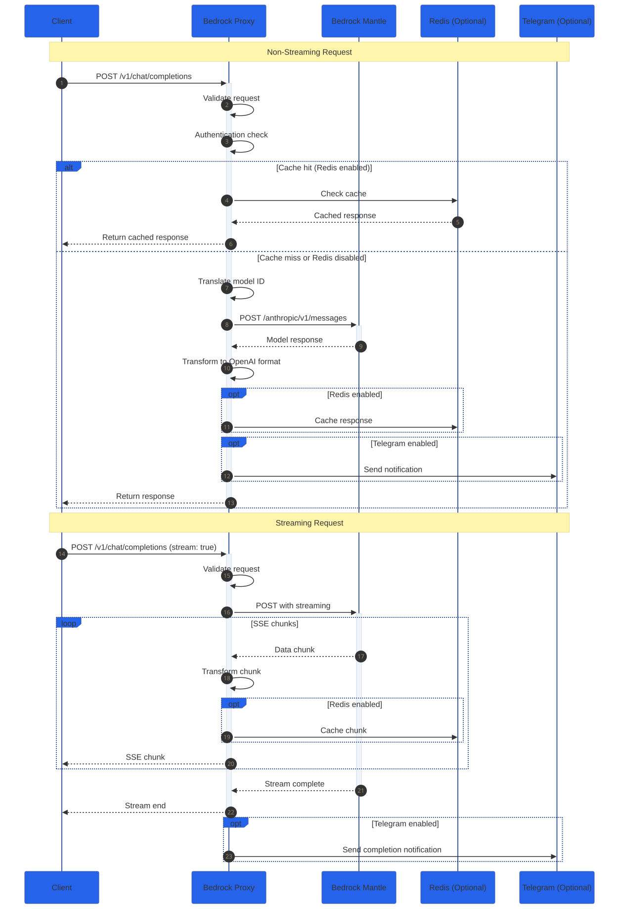

# Bedrock Proxy - Detailed Architecture

This document provides a deep dive into the architecture, component relationships, and data flows of Bedrock Proxy.

---

## Table of Contents

- [System Overview](#system-overview)
- [Component Architecture](#component-architecture)
- [Request Flow](#request-flow)
- [Live vs. Dormant Components](#live-vs-dormant-components)
- [Deployment Topology](#deployment-topology)
- [Integration Details](#integration-details)

---

## System Overview

Bedrock Proxy operates as a translation layer between AI clients (using OpenAI or Anthropic APIs) and AWS Bedrock Mantle.

### Core Flow

```
Client Request → Proxy → Bedrock Mantle → Foundation Models
                  ↓
           (transform)
                  ↓
Client Response ← Proxy ← Bedrock Response
```

### Key Responsibilities

1. **API Translation**: Converts OpenAI/Anthropic format to Bedrock Mantle format
2. **Model Routing**: Maps model IDs (e.g., `glm-5`) to Bedrock endpoints
3. **Response Streaming**: Handles SSE streaming for real-time responses
4. **Optional Integrations**: Caching, persistence, notifications, memory

---

## Component Architecture



### Request Processing Pipeline

| Stage | Description | Implementation |
|-------|-------------|----------------|
| Validation | Check request structure | `server.ts` |
| Authentication | Verify API key (optional) | Middleware |
| Translation | Convert format | `bedrock.ts` |
| Streaming | Handle SSE chunks | `bedrock.ts` |
| Transformation | Convert response | `adapters.ts` |

---

## Request Flow

### Non-Streaming Request



```
1. Client POST to /v1/chat/completions
2. Proxy validates and authenticates
3. Translate OpenAI format → Bedrock format
4. POST to Bedrock Mantle API
5. Receive Bedrock response
6. Transform to OpenAI format
7. Return to client
```

### Streaming Request

```
1. Client POST with stream: true
2. Proxy validates request
3. POST to Bedrock with streaming enabled
4. Loop: receive chunk → transform → send to client
5. Signal stream complete
```

---

## Live vs. Dormant Components



### Live Components (Active in Production)

| Component | File | Purpose |
|-----------|------|---------|
| Entry Point | `src/index.ts` | Server initialization |
| Express Routes | `src/server.ts` | API endpoint handlers |
| Bedrock Integration | `src/bedrock.ts` | Mantle API calls |
| Model Adapters | `src/adapters.ts` | Model ID mapping |
| Telegram | `src/telegram-polling.ts` | Notifications & chat |
| Logger | `src/utils/logger.ts` | Structured logging |
| Redis Cache | `src/utils/redis-cache.ts` | Response caching |

### Dormant Components (Built but Not Wired)

| Component | File | Status |
|-----------|------|--------|
| Context Middleware | `src/middleware/context.ts` | Never registered with Express |
| Trace Service | `src/services/trace-service.ts` | Never imported |
| Message Service | `src/services/message-service.ts` | Never imported |
| DB Client | `src/db/client.ts` | Not connected |
| Trace Persistence | `src/db/save-trace.ts` | Never called |

**Note**: These components are fully implemented but not connected to the live request path. They represent future observability features.

---

## Deployment Topology



### Dual-Port Setup

The proxy can run as two independent processes:

| Process | Port | Telegram | Purpose |
|---------|------|----------|---------|
| A | 2999 | Disabled | VS Code Copilot |
| B | 3000 | Enabled | OpenHands Agent |

This separation allows:
- Different clients on different ports
- Telegram integration without affecting Copilot
- Independent scaling per use case

---

## Integration Details

### AWS Bedrock Mantle

**Method**: HTTP REST API (not AWS SDK)

```typescript
// bedrock.ts
const response = await fetch(BEDROCK_URL, {
  method: 'POST',
  headers: { 'Authorization': `Bearer ${API_KEY}` },
  body: JSON.stringify(bedrockRequest)
});
```

**Endpoints**:
- `/anthropic/v1/messages` for Anthropic models
- `/v1/chat/completions` for other models

### Redis (Optional)

**Purpose**: Cache streaming response chunks

**Connection**: `REDIS_URL` environment variable

```typescript
// Object|null check
if (redis && redis.status === 'ready') {
  await redis.set(key, value, 'EX', ttl);
}
```

**Note**: Redis gracefully degrades if not configured.

### PostgreSQL (Optional)

**Purpose**: Execution trace persistence

**Status**: Database schema exists, persistence layer not wired

**Tables**:
- `execution_traces` - Request/response history
- `projects` - Project metadata

### Telegram (Optional)

**Features**:
- Push notifications for completions
- Bidirectional polling loop
- Command handling: `/clear`, `/reset`, `/history`

**Configuration**:
```env
TELEGRAM_ENABLED=true
TELEGRAM_BOT_TOKEN=your_token
TELEGRAM_CHAT_ID=your_chat_id
```

---

## API Endpoints

| Endpoint | Method | Description |
|----------|--------|-------------|
| `/health` | GET | Basic health check |
| `/alive` | GET | Liveness probe |
| `/ready` | GET | Readiness probe |
| `/v1/chat/completions` | POST | OpenAI-compatible chat |
| `/v1/messages` | POST | Anthropic-compatible messages |
| `/v1/models` | GET | List available models |

---

## Model Mapping

| Client Model ID | Bedrock Model |
|-----------------|---------------|
| `zai.glm-5` | GLM-5 (Anthropic format) |
| `glm-5` | GLM-5 (Anthropic format) |
| Model from request | Pass-through |

**Code**:
```typescript
const STATIC_MODEL_ID = 'zai.glm-5';

function resolveModelId(requestedModel: string): string {
  return requestedModel || STATIC_MODEL_ID;
}
```

---

## Error Handling

### Bedrock Errors

```typescript
try {
  const response = await fetch(bedrockUrl, options);
  if (!response.ok) {
    throw new Error(`Bedrock error: ${response.status}`);
  }
  return response;
} catch (error) {
  logger.error('Bedrock request failed', { error });
  throw error;
}
```

### Graceful Degradation

- Redis unavailable → Skip caching, continue processing
- Telegram unavailable → Log error, continue processing
- Database unavailable → Skip persistence, continue processing

---

## Performance Considerations

### Streaming vs. Non-Streaming

- **Non-streaming**: Lower latency for small responses
- **Streaming**: Better UX for long responses, progressive rendering

### Caching

Redis caching reduces latency for:
- Repeated identical requests
- Continued conversations

### Connection Pooling

Each request creates a new HTTP connection to Bedrock. Consider connection pooling for high throughput.

---

## Security

### API Key Management

- `BEDROCK_MANTLE_API_KEY` in environment
- Never logged or exposed
- Validated at startup

### Request Validation

- Model ID validation
- Message structure validation
- Max tokens limits

### Network Security

- No TLS termination at proxy level
- Relies on upstream HTTPS

---

## Monitoring

### Logs

Structured JSON logs via Winston:
```json
{
  "level": "info",
  "timestamp": "2024-01-15T10:30:00Z",
  "message": "Request processed",
  "model": "glm-5",
  "duration": 234
}
```

### Health Endpoints

- `/health` - Always returns 200 if process alive
- `/alive` - Kubernetes liveness probe
- `/ready` - Kubernetes readiness probe (checks dependencies)

### Telegram Notifications

- Request completions
- Error alerts
- Status updates

---

## Future Improvements

1. Wire dormant observability components
2. Add authentication middleware
3. Implement request rate limiting
4. Add Prometheus metrics
5. Support multi-tenant isolation
6. Add OpenTelemetry tracing

---

## References

- [AWS Bedrock Documentation](https://docs.aws.amazon.com/bedrock/)
- [OpenAI API Reference](https://platform.openai.com/docs/api-reference)
- [Anthropic API Reference](https://docs.anthropic.com/claude/reference)
